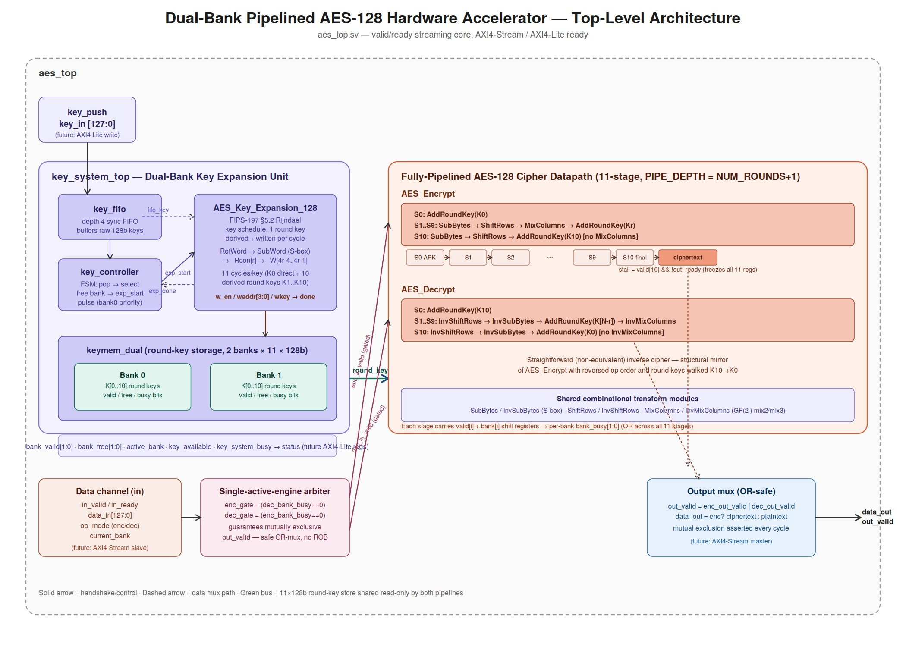
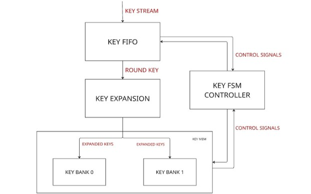
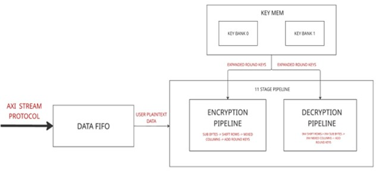
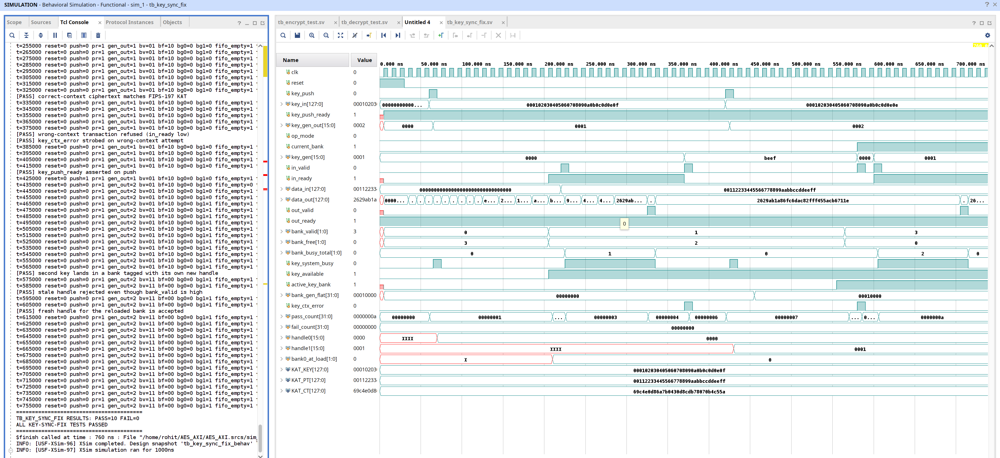
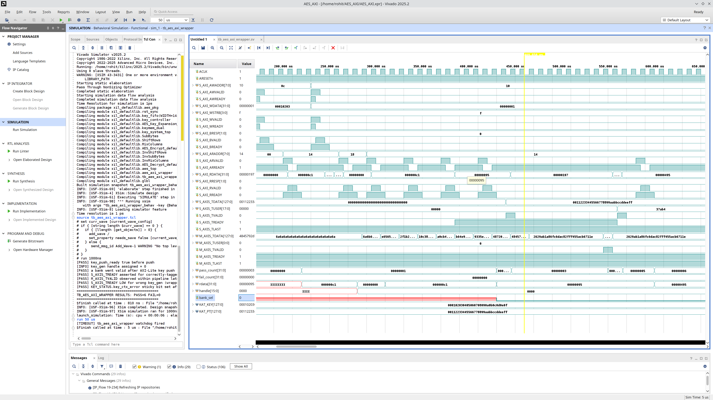
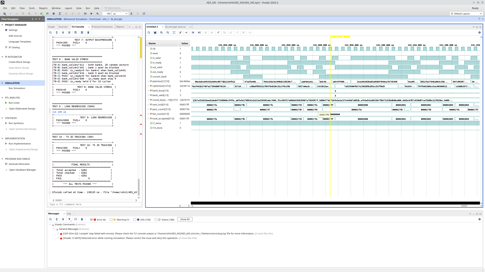
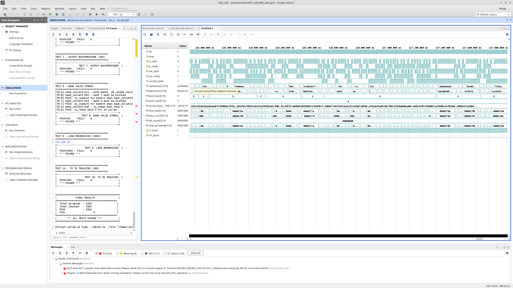
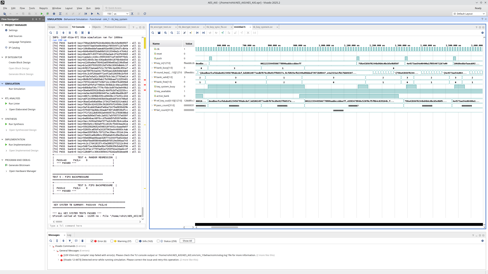

# Dual-Bank Pipelined AES-128 — AXI4-Lite and AXI4-Stream Integrated

## Overview

This repository is the **continuation and hardening pass** of [`Dual_Bank_Pipelined_AES_128_Hardware_Accelerator`](https://github.com/rohitiyer1234/Dual_Bank_Pipelined_AES_128_Hardware_Accelerator), which implemented and verified the standalone dual-bank pipelined AES-128 core (`aes_top`) behind a plain valid/ready interface.

This project takes that verified core and:

1. **Wraps it in a standard AXI4-Lite (control) + AXI4-Stream (data) shell** (`aes_axi_wrapper.sv`) — the exact interface the base repo's own "Future Work" section called for.
2. **Closes a real key/data synchronization race** in the dual-bank key system — a generation-handle protocol (`key_gen` / `bank_gen`) that guarantees a data-plane transaction can never be silently processed under the wrong round-key context, even under adversarial bank-reuse timing.
3. **Adds the full ASIC backend flow** (Yosys → OpenROAD → Magic/KLayout, SkyWater sky130A) so the wrapped design is carried from verified RTL through to physical implementation, rather than stopping at FPGA bring-up.

The underlying AES-128 cipher datapath (`AES_Encrypt`, `AES_Decrypt`, `SubBytes`/`InvSubBytes`, `ShiftRows`/`InvShiftRows`, `MixColumns`/`InvMixColumns`) is **byte-for-byte unchanged** from the base repo — this project did not touch cipher correctness, it hardened the system around it.

> **Mode note:** this accelerator implements AES-128 in **ECB mode only** — each 128-bit beat on `S_AXIS`/`M_AXIS` is encrypted or decrypted completely independently, with no chaining, counter, or authentication state carried between blocks. There is no CBC/CTR/GCM (or any other mode) anywhere in this design. `S_AXIS_TLAST` is unused for exactly this reason — see [AXI4-Stream Data Channels](#axi4-stream-data-channels).

---

## Relationship to the base project

| | Base repo (`Hardware_Accelerator`) | This repo (`AXI_Stream`) |
|---|---|---|
| Cipher datapath | 11-stage pipelined encrypt/decrypt, FIPS-197 | **Unchanged** — same files, verified with the same testbenches, same results |
| Key management | Dual-bank round-key store, background expansion, bank rotation | **Unchanged mechanism**, **extended** with a generation-handle sync tag |
| External interface | Plain valid/ready (`in_valid/in_ready`, `out_valid/out_ready`) | **New**: AXI4-Lite control/status plane + AXI4-Stream data plane |
| Key/data race | `current_bank` alone identifies the key context — no guarantee the bank still holds the key the master intended | **Fixed**: every transaction must present a `key_gen` handle that must match the bank's current `bank_gen` or the transaction is refused, observably |
| Physical implementation | FPGA (Zynq-7000/PYNQ-Z2), Vivado synthesis/implementation only | **Extended**: full ASIC backend (OpenLane2 / sky130A) added, in progress — see [ASIC Backend Status](#asic-backend-status) |
| Verification | Unit + subsystem + top-level testbenches against an independent FIPS-197 software model | **Extended**: all base-repo testbenches retained and still passing, **plus** a dedicated wrapper-level protocol testbench and a dedicated key-sync race testbench |

---

## Design Summary

| Parameter | Specification |
|------------|--------------|
| Project | Dual-Bank Pipelined AES-128 — AXI4 Accelerator |
| RTL Language | SystemVerilog |
| Cryptographic Standard | FIPS-197 AES-128, **ECB mode only** |
| Architecture Style | Fully pipelined streaming datapath behind an AXI4 shell |
| Encryption / Decryption Pipeline Depth | 11 stages each |
| Key Expansion Engine | Dedicated background Rijndael key scheduler |
| Key Storage Architecture | Dual-bank round-key memory, generation-tagged |
| Key/Data Synchronization | Hardware-enforced via `key_gen` / `bank_gen` handles |
| Control Interface | AXI4-Lite slave (key load, control, status) |
| Data Interface | AXI4-Stream slave (in) / master (out), 128-bit beats |
| Throughput | 1 × 128-bit block / clock cycle (steady state) |
| Backpressure Support | Yes — full-pipe freeze, standard AXI-Stream ready/valid |
| Verification Methodology | Self-checking testbenches, independent FIPS-197 golden model |
| Golden Reference Model | `aes_ref_pkg.sv` — independent software implementation |
| Backend Flow | OpenLane2 (Yosys / OpenROAD / Magic / KLayout), sky130A |
| Backend Status | In progress — see [ASIC Backend Status](#asic-backend-status) |

## Project Highlights

- 🔌 Full **AXI4-Lite + AXI4-Stream** shell around the previously-verified AES core — no cipher datapath changes
- 🔐 **Generation-handle key-sync fix** closes a real hardware race between key rotation and in-flight data transactions
- 🧪 **10/10** dedicated key-sync race tests passed (`tb_key_sync_fix.sv`), including adversarial stale-handle rejection
- 🧪 **6/6** wrapper-level AXI protocol + KAT tests passed (`tb_aes_axi_wrapper.sv`)
- 🧪 All pre-existing core-level regressions carried over **unchanged and still passing**: 6,281 encryption vectors, 6,281 decryption vectors, 49 key-system tests
- 🏗️ Complete ASIC backend flow scaffolded: Yosys synthesis, OpenROAD floorplan/place/CTS/route, sky130A PDK signoff, in active convergence

## Table of Contents

- [Relationship to the base project](#relationship-to-the-base-project)
- [Architecture Overview](#architecture-overview)
- [The Key-Sync Fix — Why It Was Needed](#the-key-sync-fix--why-it-was-needed)
- [AXI4-Lite Register Map](#axi4-lite-register-map)
- [AXI4-Stream Data Channels](#axi4-stream-data-channels)
- [Module Reference](#module-reference)
- [Verification Environment](#verification-environment)
- [Verification Results](#verification-results)
- [ASIC Backend Status](#asic-backend-status)
- [Repository Layout](#repository-layout)
- [Running the Simulations](#running-the-simulations)
- [Running the Backend Flow](#running-the-backend-flow)
- [Design Notes, Trade-Offs, and Known Limitations](#design-notes-trade-offs-and-known-limitations)
- [Future Work](#future-work)

---

## Architecture Overview

The accelerator retains the base project's three subsystems — dual-bank key management, AES encrypt/decrypt datapaths, and streaming control — now sitting behind a standardized AXI4 shell:



### Dual-Bank Key Management Architecture



### AES Cipher Engine Architecture



### AXI4 Wrapper — `aes_axi_wrapper`

```
                 ┌─────────────────────────────────────────────┐
  S_AXI (Lite) ─▶│  AXI4-Lite register file                     │
                 │  (key staging, control, status, debug)       │
                 └───────────────┬───────────────────────────────┘
                                 │ key_push / key_in / key_gen_out
                                 ▼
  S_AXIS ───────▶┌─────────────────────────────────────────────┐───────▶ M_AXIS
  (data in)      │              aes_top (unchanged core)        │   (data out)
                 │  key_system_top  +  AES_Encrypt / AES_Decrypt │
                 │  + key_ctx_ok gate (NEW)                      │
                 └─────────────────────────────────────────────┘
```

`ACLK` drives both the AXI shell and the core; `ARESETn` (async, active-low, standard AXI) is converted to the core's synchronous active-high `reset` by `rst_sync.sv`. This is a deliberate single-clock-domain simplification — see [Design Notes](#design-notes-trade-offs-and-known-limitations).

---

## The Key-Sync Fix — Why It Was Needed

In the base repo, a data-plane transaction names its key context with nothing more than `current_bank` — a bare 1-bit slot index. That's a real gap once key rotation becomes software-visible through an AXI interface: a bank can be released and reloaded with a *different* key between the moment a master decides "use bank 0" and the moment its transaction is actually accepted, if the master queues data faster than it re-checks status, or simply has a bug. The core would have no way to detect this — it would silently encrypt or decrypt under the wrong key.

**The fix:** every accepted key push is stamped with a monotonically-incrementing 16-bit **generation handle** (`key_gen_t`, `aes_pkg.sv`). That handle is:

1. Returned to software via `KEY_GEN_HANDLE` (AXI4-Lite `0x18`) immediately after the push that populated a bank.
2. Latched into `keymem_dual.bank_gen_reg[]` at the start of that bank's expansion (on the K0 write, `waddr==0`) — stable well before `bank_valid` can possibly go high, so it's always correct by the time any consumer reads it.
3. Required on every data-plane transaction, via `S_AXIS_TUSER[17:2]` (`key_gen`) alongside `current_bank`.

`aes_top` now gates acceptance on `key_ctx_ok = (key_gen == bank_gen[current_bank])`, evaluated combinationally from already-registered state, at the exact same timing class as the existing `bank_valid[current_bank]` gate it sits beside:

```systemverilog
assign key_ctx_ok    = (key_gen == bank_gen_flat[current_bank*KEY_GEN_W +: KEY_GEN_W]);
assign key_ctx_error = in_valid && bank_valid[current_bank] && !key_ctx_ok;

assign enc_in_valid = in_valid && !op_mode && enc_gate && key_ctx_ok;
assign dec_in_valid = in_valid &&  op_mode && dec_gate && key_ctx_ok;
```

A mismatched transaction is never silently processed — it simply never asserts `in_ready` (identical in shape to the bank-not-valid case), so from the AXI master's point of view it looks like ordinary backpressure. For debug visibility, `key_ctx_error` pulses for exactly one cycle on every refusal, and is latched as a **sticky** status bit (`KEY_STATUS` bit 10) plus a saturating counter (`KEY_CTX_ERR_CNT`, `0x20`) — so "core is busy" and "you named a stale key context" are observably distinguishable during bring-up.

This mechanism is validated end-to-end by the dedicated `tb_key_sync_fix.sv` testbench — see [Verification Results](#verification-results).



The waveform above shows the actual handle lifecycle under test: `key_gen_out` advancing (`0000` → `0001` → `0002`) as successive keys are pushed, `bank_gen_flat` latching each handle into its bank, `key_ctx_error` strobing exactly once on a deliberately-mistagged transaction, and `handle0`/`handle1` tracking which generation each bank currently holds — including the case where a stale handle is correctly rejected even while `bank_valid` reads high for that bank.

---

## AXI4-Lite Register Map

32-bit registers, word-aligned, 4-byte stride (`C_S_AXI_ADDR_WIDTH = 8`, 0x00–0xFF):

| Offset | Name | R/W | Contents |
|---|---|---|---|
| `0x00` | `KEY_IN0` | W | `key_in[31:0]` — stage word 0 of next key |
| `0x04` | `KEY_IN1` | W | `key_in[63:32]` |
| `0x08` | `KEY_IN2` | W | `key_in[95:64]` |
| `0x0C` | `KEY_IN3` | W | `key_in[127:96]` |
| `0x10` | `KEY_CTRL` | W | bit 0 = `PUSH`: pushes staged `KEY_IN0..3` into the key FIFO (one-cycle, self-clearing pulse; write-only, reads as 0) |
| `0x14` | `KEY_STATUS` | R | bit 0 `key_push_ready` (0 ⇒ last push may have been dropped, FIFO was full) · bit 1 `key_system_busy` · bit 2 `key_available` · bit 3 `active_key_bank` · [5:4] `bank_valid[1:0]` · [7:6] `bank_free[1:0]` · [9:8] `bank_busy_total[1:0]` · bit 10 `key_ctx_error` (**sticky** — set since last cleared) |
| `0x18` | `KEY_GEN_HANDLE` | R | `[15:0]` generation handle of the **most recently accepted** key push — capture this immediately and echo it on `S_AXIS_TUSER` |
| `0x1C` | `BANK_GEN` | R | `[15:0]` = bank 0's current generation, `[31:16]` = bank 1's |
| `0x20` | `KEY_CTX_ERR_CNT` | R/W1C | Saturating mismatch counter; any write clears both this and `KEY_STATUS` bit 10 |
| `0x24` | `IP_VERSION` | R | Constant `0x41455331` ("AES1") — bring-up sanity ID |

All unmapped offsets in the 0x000–0x3FF window read 0 and ignore writes (decoded, not aliased — avoids silent mis-hits).

---

## AXI4-Stream Data Channels

**`S_AXIS` (slave, data in):**

| Signal | Width | Meaning |
|---|---|---|
| `S_AXIS_TDATA` | 128 | plaintext (`op_mode=0`) or ciphertext (`op_mode=1`) |
| `S_AXIS_TUSER` | 18 | `[0]` `op_mode` · `[1]` `current_bank` · `[17:2]` `key_gen` (the generation handle from `KEY_GEN_HANDLE`) |
| `S_AXIS_TVALID/TREADY` | — | standard handshake |
| `S_AXIS_TLAST` | 1 | **expected tied high by the master** — this core has no multi-beat packet concept; every beat is one independent 128-bit ECB block |

**`M_AXIS` (master, data out):**

| Signal | Width | Meaning |
|---|---|---|
| `M_AXIS_TDATA` | 128 | result block |
| `M_AXIS_TUSER` | 1 | `op_mode` this result was produced under |
| `M_AXIS_TVALID/TREADY` | — | standard handshake |
| `M_AXIS_TLAST` | 1 | tied high — see above |

Because every beat is a self-contained ECB block with no cross-block state, `TLAST` carries no framing information here and is correctly unused on the input side (flagged by lint, confirmed intentional — see the project's RTL audit notes in `docs/`). **This is also why there is no CBC/CTR/GCM mode anywhere in this design** — those modes require exactly the kind of inter-block chaining state this architecture deliberately does not carry.

---

## Module Reference

| Module | File | Role |
|---|---|---|
| `aes_axi_wrapper` | `wrapper/aes_axi_wrapper.sv` | **New.** AXI4-Lite + AXI4-Stream shell around `aes_top`; register file, key staging, `key_ctx_ok`-aware handshake translation |
| `rst_sync` | `wrapper/rst_sync.sv` | **New.** Async `ARESETn` → synchronous active-high `reset` |
| `aes_top` | `rtl/aes_top.sv` | Top-level integration; **extended** with `key_ctx_ok` acceptance gate, `key_push_ready`/`key_gen_out`/`bank_gen_flat`/`key_ctx_error` ports |
| `key_system_top` | `rtl/key_system/key_system_top.sv` | Composes FIFO + controller + expansion engine + dual-bank memory; **extended** to relay generation handles |
| `key_fifo` | `rtl/key_system/key_fifo.sv` | **Extended**: now `WIDTH`-generic so a key and its generation handle travel as one atomic FIFO entry; `full` is now observable (previously a push-while-full silently dropped the key) |
| `AES_Key_Expansion_128` | `rtl/key_system/AES_Key_Expansion.sv` | Unchanged — FIPS-197 §5.2 Rijndael key schedule |
| `keymem_dual` | `rtl/key_system/keymem_dual.sv` | **Extended**: `bank_gen_reg[]` / `bank_gen_flat` generation tracking alongside the existing dual-bank round-key store |
| `AES_Encrypt` / `AES_Decrypt` | `rtl/encrypt/AES_Encrypt.sv` / `rtl/decrypt/AES_Decrypt.sv` | Unchanged — 11-stage pipelined forward/inverse cipher |
| `SubBytes`/`InvSubBytes`, `ShiftRows`/`InvShiftRows`, `MixColumns`/`InvMixColumns` | `rtl/encrypt/`, `rtl/decrypt/` | Unchanged transform primitives |
| `aes_pkg` | `rtl/aes_pkg.sv` | **Extended**: adds `KEY_GEN_W`, `key_gen_t` for the generation-handle mechanism |
| `aes_ref_pkg` | `rtl/aes_ref_pkg.sv` | Unchanged — independent FIPS-197 software golden model |

---

## Verification Environment

All verification in this repo targets **Vivado 2025.2 XSIM** (behavioral simulation), run from the `AES_AXI` project.

### New/extended testbenches

- **`tb_aes_axi_wrapper.sv`** (new) — wrapper-level protocol testbench, driving the DUT purely through its AXI4-Lite and AXI4-Stream ports (no hierarchical pokes into `aes_top`). Confirms: key-push readiness and handle assignment over AXI-Lite, a bank going valid after an AXI-Lite key push, `S_AXIS_TREADY` correctly asserted for a correctly-tagged transaction, `M_AXIS_TVALID` observed within the expected pipeline latency, `S_AXIS_TREADY` correctly held low for a transaction carrying the wrong `key_gen`, and the `KEY_STATUS.key_ctx_error` sticky bit setting on exactly that case.
- **`tb_key_sync_fix.sv`** (new) — dedicated race/adversarial testbench for the generation-handle mechanism specifically, independent of the AXI shell. Confirms: correct-context ciphertext matches the FIPS-197 KAT, a wrong-context transaction is refused (`in_ready` held low), `key_ctx_error` strobes on exactly the wrong-context attempt, `key_push_ready` asserts correctly on push, a second key lands in a bank tagged with its own distinct new handle, a stale handle is rejected **even while `bank_valid` reads high** for that bank (the actual race this project set out to close), and a fresh handle for a reloaded bank is accepted.

### Carried over unchanged

- `tb_encrypt_test.sv`, `tb_decrypt_test.sv`, `tb_key_system.sv`, `tb_aes_top.sv` — identical to the base repo, run here to confirm the cipher datapath and key-system mechanics are untouched by the AXI integration and key-sync work.

---

## Verification Results

### AXI Wrapper — Protocol + KAT



The waveform shows a full AXI-Lite key push (`S_AXI_AWVALID`/`WVALID`/`BVALID` sequence) followed by AXI-Stream data transactions (`S_AXIS_TDATA`/`TUSER`/`TVALID` → `M_AXIS_TDATA`/`TVALID`), `bank_sel` tracking the active bank, and `rdata`/`handle` fields confirming register readback.

| Test | Result |
|---|---|
| `key_push_ready` true before push | PASS |
| Key-gen handle assigned on push | PASS (confirmed = 0 for first push) |
| Bank went valid after AXI-Lite key push | PASS |
| `S_AXIS_TREADY` asserted for correctly-tagged transaction | PASS |
| `M_AXIS_TVALID` observed within pipeline latency | PASS |
| `S_AXIS_TREADY` low for wrong `key_gen` (wrapper-level mismatch) | PASS |
| `KEY_STATUS.key_ctx_error` sticky bit set after mismatch | PASS |

**`TB_AES_AXI_WRAPPER RESULTS: PASS=6 FAIL=0`**

### Key-Sync Fix — Dedicated Race Testbench

**`TB_KEY_SYNC_FIX RESULTS: PASS=10 FAIL=0 — ALL KEY-SYNC-FIX TESTS PASSED`**

| Test | Result |
|---|---|
| Correct-context ciphertext matches FIPS-197 KAT | PASS |
| Wrong-context transaction refused (`in_ready` low) | PASS |
| `key_ctx_error` strobed on wrong-context attempt | PASS |
| `key_push_ready` asserted on push | PASS |
| Second key lands in a bank tagged with its own new handle | PASS |
| Stale handle rejected even though `bank_valid` is high | PASS |
| Fresh handle for the reloaded bank is accepted | PASS |

### AES Encryption Pipeline (carried over, confirmed unchanged)



Includes output-backpressure stress (PASS=200), bank-valid stress across all four `bank_valid` combinations (PASS=40), a 5,000-vector long-regression soak, and TX-ID ordering tracking (PASS=300).

**Total accepted = 6,281, checked = 6,281, PASS = 6,281, FAIL = 0 — ALL TESTS PASSED**

### AES Decryption Pipeline (carried over, confirmed unchanged)



Same test structure as encryption, independently re-run against this repo's RTL.

**Total accepted = 6,281, checked = 6,281, PASS = 6,281, FAIL = 0 — ALL TESTS PASSED**

### Key Management Subsystem (carried over, confirmed unchanged)



Random regression over 40 independently-generated keys (each checked round-by-round, all 11 round keys, against the reference key schedule) plus FIFO-backpressure stress.

**`KEY SYSTEM TB SUMMARY: PASS=49 FAIL=0 — ALL KEY SYSTEM TESTS PASSED`**

### Results summary

| Suite | Scope | Result |
|---|---|---|
| `tb_aes_axi_wrapper.sv` | AXI4-Lite + AXI4-Stream protocol, end-to-end through the wrapper | **PASS = 6, FAIL = 0** |
| `tb_key_sync_fix.sv` | Generation-handle race/adversarial coverage | **PASS = 10, FAIL = 0** |
| `tb_key_system.sv` | Key management subsystem (unchanged from base repo) | **PASS = 49, FAIL = 0** |
| `tb_encrypt_test.sv` | Encryption datapath (unchanged from base repo) | **PASS = 6,281, FAIL = 0** |
| `tb_decrypt_test.sv` | Decryption datapath (unchanged from base repo) | **PASS = 6,281, FAIL = 0** |

---

## ASIC Backend Status

This repository includes the complete scaffolding for an ASIC implementation of `aes_axi_wrapper` on the open SkyWater **sky130A** PDK, using **OpenLane2** (Yosys for synthesis, OpenROAD for floorplan/placement/CTS/routing, Magic and KLayout for DRC/LVS signoff):

- `config.json` — OpenLane2 flow configuration (clock period, floorplan utilization, resizer/CTS tuning, SDC/netlist paths)
- `constraints/aes_axi_wrapper.sdc` — timing constraints
- `synth_v2005/aes_axi_wrapper_flat.v` — `sv2v`-flattened, Yosys-elaboration-clean synthesizable netlist of the full design (wrapper + core)
- `scripts/filelist.f`, `scripts/sky130_yosys_synth.tcl` — standalone synthesis helpers
- `docs/openlane2_flow_guide.md`, `docs/how_to_run.md`, `docs/FIX_AND_BACKEND_README.md` — full backend run instructions, toolchain setup, and a record of the RTL-level fixes made specifically to make this design synthesis-clean (an unguarded SystemVerilog `assert`/`$time` construct, SDC portability issues, and related items)

**Status:** the backend flow is in active bring-up — synthesis and SDC compatibility issues have been resolved and the flow is being carried through placement, CTS, and routing toward timing signoff. This section will be updated with final PPA (power/performance/area) and signoff results once post-route STA, DRC, and LVS all close cleanly across every PVT corner. See `docs/how_to_run.md` for the current, exact reproduction steps.

---

## Repository Layout

```
.
├── config.json                        # OpenLane2 backend flow configuration
├── constraints/
│   └── aes_axi_wrapper.sdc            # timing constraints
├── docs/
│   ├── openlane2_flow_guide.md        # full backend flow walkthrough
│   ├── how_to_run.md                  # exact reproduction steps (sim + backend)
│   └── FIX_AND_BACKEND_README.md      # synthesis-readiness fix log
├── images/                            # architecture diagrams + verification waveforms
├── packages/
│   ├── aes_pkg.sv                     # shared params/typedefs (+ key_gen_t)
│   └── aes_ref_pkg.sv                 # independent golden reference model
├── rtl/
│   ├── aes_pkg.sv
│   ├── aes_ref_pkg.sv
│   ├── aes_top.sv                     # extended with key_ctx_ok gate
│   ├── key_system/
│   │   ├── key_fifo.sv                # WIDTH-generic, full visibility fix
│   │   ├── key_controller.sv
│   │   ├── AES_Key_Expansion.sv
│   │   ├── keymem_dual.sv             # extended with bank_gen tracking
│   │   └── key_system_top.sv
│   ├── encrypt/                       # unchanged cipher datapath
│   └── decrypt/                       # unchanged cipher datapath
├── wrapper/
│   ├── aes_axi_wrapper.sv             # NEW — AXI4-Lite + AXI4-Stream shell
│   ├── rst_sync.sv                    # NEW — async reset synchronizer
│   └── tb_aes_axi_wrapper.sv          # NEW — wrapper-level protocol testbench
├── tb/
│   ├── tb_key_system.sv               # unchanged
│   ├── tb_encrypt_test.sv             # unchanged
│   ├── tb_decrypt_test.sv             # unchanged
│   └── tb_aes_top.sv                  # unchanged
├── scripts/
│   ├── filelist.f
│   └── sky130_yosys_synth.tcl
├── synth_v2005/
│   └── aes_axi_wrapper_flat.v         # sv2v-flattened, synthesis-clean netlist
└── rtl/tb_key_sync_fix.sv             # NEW — dedicated key-sync race testbench
```

---

## Running the Simulations

**Vivado (XSIM)** — verified environment (project: `AES_AXI`, Vivado 2025.2):

```tcl
# In Vivado, add all .sv sources under rtl/, packages/, wrapper/, tb/,
# set the desired testbench as simulation top, then:
launch_simulation
run all
```

Run each of the following independently — each is self-contained and self-checking, printing a `PASS`/`FAIL` banner per test group and a final results summary:

- `tb_aes_axi_wrapper` — AXI4-Lite + AXI4-Stream protocol compliance
- `tb_key_sync_fix` — generation-handle race/adversarial coverage
- `tb_key_system`, `tb_encrypt_test`, `tb_decrypt_test`, `tb_aes_top` — unchanged core-level regressions

## Running the Backend Flow

See `docs/how_to_run.md` for exact, step-by-step OpenLane2 setup and invocation (Nix shell environment, sky130A PDK provisioning via `volare`, and the `openlane` run command against `config.json`), and `docs/openlane2_flow_guide.md` for a full walkthrough of every flow stage and the tuning knobs relevant to convergence.

---

## Design Notes, Trade-Offs, and Known Limitations

- **ECB mode only, by design.** No CBC/CTR/GCM or any other chained/authenticated mode is implemented. Every beat is an independent 128-bit block — this is why `TLAST` carries no meaning here and `S_AXIS_TLAST` is simply expected tied high.
- **Single clock domain, no CDC.** `ACLK` drives both the AXI shell and the core. If the core needs to run on a different clock than the surrounding fabric in a given SoC integration, add a standard AXI-CDC/register-slice IP between this wrapper and the fabric — this was a deliberate scope decision to keep this pass focused on fixing the key/data correctness gap, not on introducing new CDC surface area.
- **Key material never exposed on AXI-readable registers.** Only status/handle bits are readable (`KEY_STATUS`, `KEY_GEN_HANDLE`, `BANK_GEN`) — matching standard accelerator practice of keeping key material off observable interfaces.
- **Generation handle is 16 bits, free-running.** At expected key-rotation rates this does not realistically wrap within an operational window; if an integration anticipates extremely high key-churn rates, this is the field to widen.
- All trade-offs inherited from the base repo (full-pipe stall rather than per-stage bubbles, single-active-engine arbitration between encrypt/decrypt, bank-0-priority allocation, fixed AES-128/10-round schedule) are unchanged — see the base repo's README for the full rationale on each.

## Future Work

- Complete ASIC backend convergence: post-route timing signoff across all PVT corners, DRC/LVS/antenna clean, final PPA report (this section of this README will be updated accordingly).
- Gate-level simulation of the backend netlist against the same KAT regressions used for RTL verification, to confirm synthesis preserved function.
- FPGA bring-up of the AXI-wrapped design (PYNQ-Z2 / Zynq-7000), extending the base repo's FPGA target to this AXI-integrated version.
- Extend the generation-handle mechanism's test coverage to constrained-random/coverage-driven scenarios (beyond the current directed adversarial set in `tb_key_sync_fix.sv`).
- AES-192/AES-256 key schedule and pipeline-depth extension (inherited from base repo's future work, still open).
- A chained/authenticated mode (e.g. GCM) is a natural next step once ECB-mode hardware and backend flow are fully closed out — explicitly out of scope for this repository.
