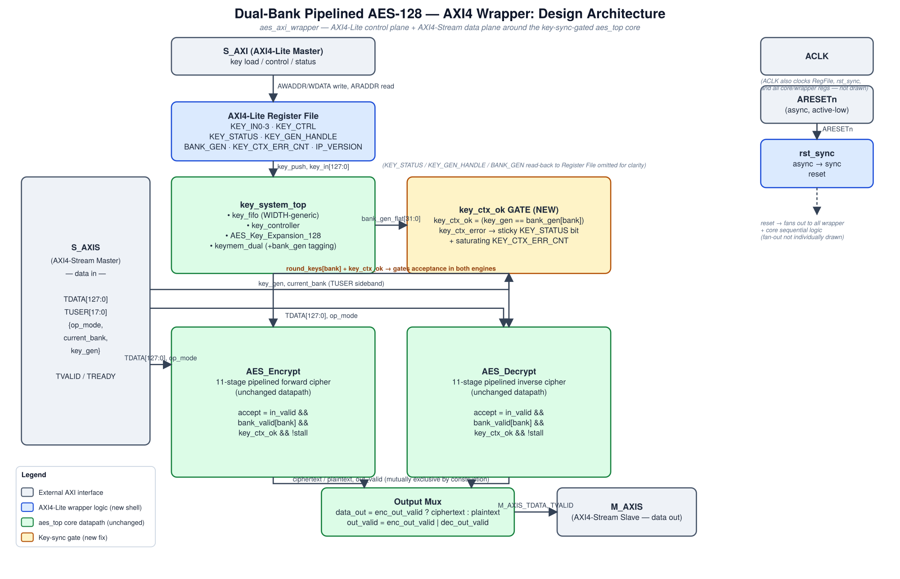
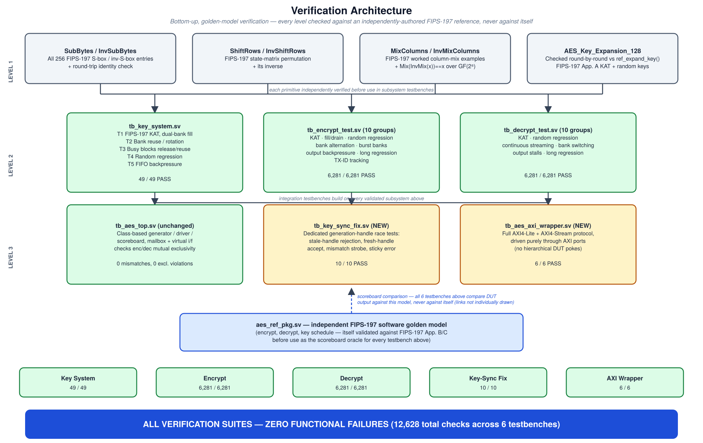
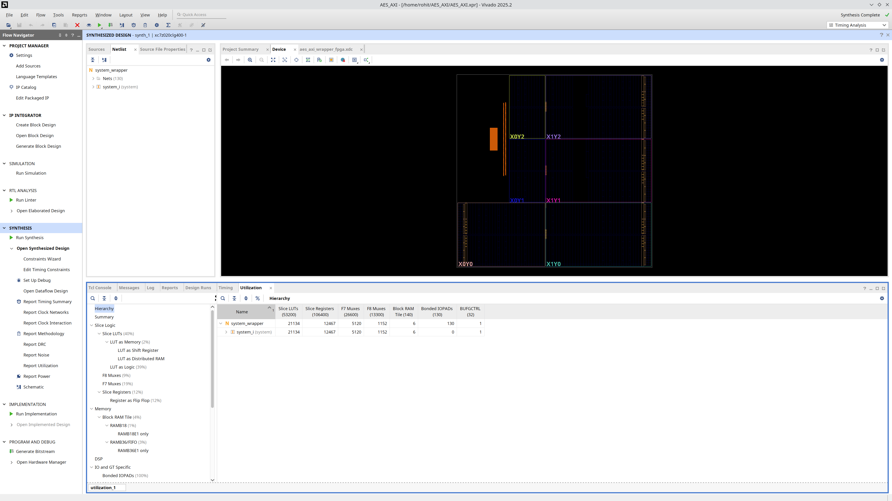
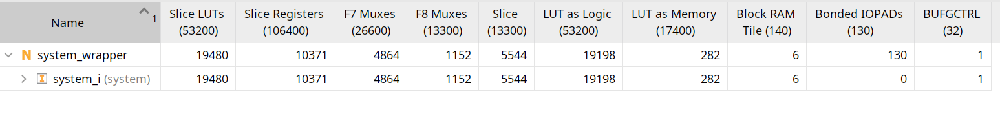
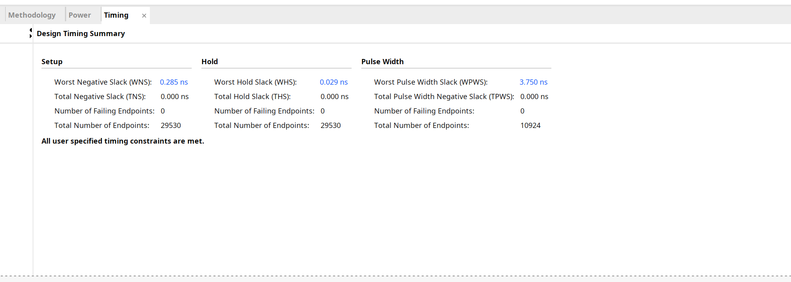
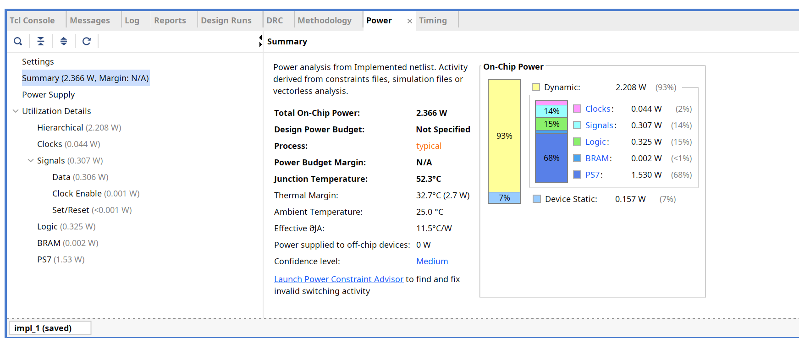

# Dual-Bank Pipelined AES-128 — AXI4 Accelerator (FPGA-Closed, ASIC Backend In Progress)

## Overview

This repository is the **continuation and hardening pass** of [`Dual_Bank_Pipelined_AES_128_Hardware_Accelerator`](https://github.com/rohitiyer1234/Dual_Bank_Pipelined_AES_128_Hardware_Accelerator), which implemented and verified the standalone dual-bank pipelined AES-128 core (`aes_top`) behind a plain valid/ready interface.

This project takes that verified core and:

1. **Wraps it in a standard AXI4-Lite (control) + AXI4-Stream (data) shell** (`aes_axi_wrapper.sv`) — the exact interface the base repo's own "Future Work" section called for.
2. **Closes a real key/data synchronization race** in the dual-bank key system — a generation-handle protocol (`key_gen` / `bank_gen`) that guarantees a data-plane transaction can never be silently processed under the wrong round-key context, even under adversarial bank-reuse timing.
3. **Integrates the full AXI system into a real Zynq block design and closes timing on actual PYNQ-Z2 hardware** (Xilinx Zynq-7020, `xc7z020clg400-1`) — implementation complete, **0 failing timing endpoints** across setup, hold, and pulse width, and re-confirmed functionally correct via **post-implementation (SDF-backannotated) timing simulation**, not just RTL-level simulation.
4. **Adds the full ASIC backend flow** (Yosys → OpenROAD → Magic/KLayout, SkyWater sky130A) so the same wrapped design is also being carried through to physical ASIC implementation — this track is separate from the FPGA work above and is still in progress.

The underlying AES-128 cipher datapath (`AES_Encrypt`, `AES_Decrypt`, `SubBytes`/`InvSubBytes`, `ShiftRows`/`InvShiftRows`, `MixColumns`/`InvMixColumns`) is **byte-for-byte unchanged** from the base repo — this project did not touch cipher correctness, it hardened the system around it and carried it through to silicon-ready implementation on two separate targets.

> **Mode note:** this accelerator implements AES-128 in **ECB mode only** — each 128-bit beat on `S_AXIS`/`M_AXIS` is encrypted or decrypted completely independently, with no chaining, counter, or authentication state carried between blocks. There is no CBC/CTR/GCM (or any other mode) anywhere in this design. `S_AXIS_TLAST` is unused for exactly this reason.

---

## Relationship to the base project

| | Base repo (`Hardware_Accelerator`) | This repo (`AXI_Stream`) |
|---|---|---|
| Cipher datapath | 11-stage pipelined encrypt/decrypt, FIPS-197 | **Unchanged** — same files, verified with the same testbenches, same results |
| Key management | Dual-bank round-key store, background expansion, bank rotation | **Unchanged mechanism**, **extended** with a generation-handle sync tag |
| External interface | Plain valid/ready (`in_valid/in_ready`, `out_valid/out_ready`) | **New**: AXI4-Lite control/status plane + AXI4-Stream data plane |
| Key/data race | `current_bank` alone identifies the key context — no guarantee the bank still holds the key the master intended | **Fixed**: every transaction must present a `key_gen` handle that must match the bank's current `bank_gen` or the transaction is refused, observably |
| FPGA implementation | FPGA target identified (Zynq-7000/PYNQ-Z2) | **Closed**: full Zynq block-design integration, implementation complete, timing closed (0 failing endpoints), confirmed via post-implementation timing simulation on `xc7z020clg400-1` |
| ASIC implementation | Not attempted | **In progress**: OpenLane2 / sky130A backend scaffolded and in active convergence |
| Verification | Unit + subsystem + top-level testbenches against an independent FIPS-197 software model | **Extended**: all base-repo testbenches retained and still passing, **plus** a dedicated wrapper-level protocol testbench, a dedicated key-sync race testbench, and that same wrapper testbench re-run as a **post-implementation timing simulation** |

---

## Design Summary

| Parameter | Specification |
|------------|--------------|
| Project | Dual-Bank Pipelined AES-128 — AXI4 Accelerator |
| RTL Language | SystemVerilog |
| Cryptographic Standard | FIPS-197 AES-128, **ECB mode only** |
| Architecture Style | Fully pipelined streaming datapath behind an AXI4 shell |
| Encryption / Decryption Pipeline Depth | 11 stages each |
| Key Expansion Engine | Dedicated background Rijndael key scheduler |
| Key Storage Architecture | Dual-bank round-key memory, generation-tagged |
| Key/Data Synchronization | Hardware-enforced via `key_gen` / `bank_gen` handles |
| Control Interface | AXI4-Lite slave (key load, control, status) |
| Data Interface | AXI4-Stream slave (in) / master (out), 128-bit beats |
| Throughput | 1 × 128-bit block / clock cycle (steady state) |
| Backpressure Support | Yes — full-pipe freeze, standard AXI-Stream ready/valid |
| Verification Methodology | Self-checking testbenches, independent FIPS-197 golden model |
| Golden Reference Model | `aes_ref_pkg.sv` — independent software implementation |
| **FPGA Target** | **Xilinx Zynq-7020, `xc7z020clg400-1` (PYNQ-Z2) — implementation complete, timing closed** |
| **FPGA On-Chip Power** | **2.366 W total (2.208 W dynamic, 0.157 W static)** |
| ASIC Backend Flow | OpenLane2 (Yosys / OpenROAD / Magic / KLayout), sky130A |
| ASIC Backend Status | In progress |

## Project Highlights

- 🔌 Full **AXI4-Lite + AXI4-Stream** shell around the previously-verified AES core — no cipher datapath changes
- 🔐 **Generation-handle key-sync fix** closes a real hardware race between key rotation and in-flight data transactions
- 🧪 **10/10** dedicated key-sync race tests passed (`tb_key_sync_fix.sv`), including adversarial stale-handle rejection
- 🧪 **6/6** wrapper-level AXI protocol + KAT tests passed (`tb_aes_axi_wrapper.sv`) — **at both RTL and post-implementation (SDF-timing) simulation**
- 🧪 All pre-existing core-level regressions carried over **unchanged and still passing**: 6,281 encryption vectors, 6,281 decryption vectors, 49 key-system tests
- ✅ **FPGA timing closed** on PYNQ-Z2 (Zynq-7020): **0 failing endpoints** across setup (29,530), hold (29,530), and pulse-width (10,924) — "All user specified timing constraints are met"
- ✅ **Post-implementation timing simulation** (real routed delays, not ideal/zero-delay) reproduces the identical RTL-level result: `PASS=6 FAIL=0`
- 🏗️ ASIC backend flow scaffolded in parallel: Yosys synthesis, OpenROAD floorplan/place/CTS/route, sky130A PDK signoff, in active convergence

## Verification Results — At a Glance

| Suite | Scope | Result |
|---|---|---|
| `tb_aes_axi_wrapper.sv` (RTL / behavioral) | AXI4-Lite + AXI4-Stream protocol, end-to-end through the wrapper | **PASS = 6, FAIL = 0** |
| `tb_aes_axi_wrapper.sv` (**post-implementation, SDF timing**) | Identical suite, re-run against the implemented netlist with real routed delays on `xc7z020clg400-1` | **PASS = 6, FAIL = 0** |
| `tb_key_sync_fix.sv` | Generation-handle race/adversarial coverage | **PASS = 10, FAIL = 0** |
| `tb_key_system.sv` | Key management subsystem (unchanged from base repo) | **PASS = 49, FAIL = 0** |
| `tb_encrypt_test.sv` | Encryption datapath (unchanged from base repo) | **PASS = 6,281, FAIL = 0** |
| `tb_decrypt_test.sv` | Decryption datapath (unchanged from base repo) | **PASS = 6,281, FAIL = 0** |

**Total: 12,628 RTL-level checks across 6 testbenches — zero functional failures — plus a full post-implementation timing-simulation re-confirmation of the wrapper suite.** Full nature-of-test detail and per-subsystem waveforms are below.

## Table of Contents

- [Relationship to the base project](#relationship-to-the-base-project)
- [Complete Design Architecture](#complete-design-architecture)
- [The Key-Sync Fix — Why It Was Needed](#the-key-sync-fix--why-it-was-needed)
- [AXI4-Lite Register Map](#axi4-lite-register-map)
- [AXI4-Stream Data Channels](#axi4-stream-data-channels)
- [Module Reference](#module-reference)
- [Complete Verification Architecture](#complete-verification-architecture)
- [Detailed Results by Subsystem](#detailed-results-by-subsystem)
  - [1. Key Management System](#1-key-management-system)
  - [2. Encryption Pipeline](#2-encryption-pipeline)
  - [3. Decryption Pipeline](#3-decryption-pipeline)
  - [4. AXI4 Wrapper (Integration)](#4-axi4-wrapper-integration)
- [FPGA Implementation Results (PYNQ-Z2 / Zynq-7020)](#fpga-implementation-results-pynq-z2--zynq-7020)
- [ASIC Backend Status](#asic-backend-status)
- [Repository Layout](#repository-layout)
- [Running the Simulations](#running-the-simulations)
- [Running the Backend Flow](#running-the-backend-flow)
- [Design Notes, Trade-Offs, and Known Limitations](#design-notes-trade-offs-and-known-limitations)
- [Future Work](#future-work)

---

## Complete Design Architecture



The diagram above is the authoritative system view — color-coded by origin (external AXI interface, new wrapper logic, unchanged core datapath, new key-sync gate) so it's immediately clear what this project added versus what it inherited.

### Data and control flow, stage by stage

**1. Key load (AXI4-Lite, control plane).** A software master writes a 128-bit key across four 32-bit words (`KEY_IN0`–`KEY_IN3`), then pulses `KEY_CTRL.PUSH`. The register file forwards `key_push`/`key_in[127:0]` into `key_system_top`, which queues the key in `key_fifo` (now `WIDTH`-generic, carrying the key *and* its soon-to-be-assigned generation handle as one atomic FIFO entry).

**2. Background key expansion.** `key_controller` pulls the next FIFO entry, selects a free bank (`bank_free != 2'b00`), and drives `AES_Key_Expansion_128` to compute all 11 round keys via the standard Rijndael schedule. `keymem_dual` stores them, and — this is the new part — stamps that bank's `bank_gen_reg[]` with the key's generation handle **at the very first write (`waddr==0`)**, so the tag is correct and stable long before `bank_valid` can possibly go high for that bank.

**3. Handle readback.** Software reads `KEY_GEN_HANDLE` (`0x18`) to learn the handle just assigned, and must carry that value on every subsequent data-plane transaction that should use this key.

**4. Data transaction (AXI4-Stream, data plane).** Each `S_AXIS` beat carries `TDATA[127:0]` (plaintext or ciphertext) and an 18-bit `TUSER` sideband: `op_mode` (encrypt/decrypt select), `current_bank`, and the 16-bit `key_gen` the master believes is still valid for that bank.

**5. The key-sync gate (new).** Before anything is accepted into the cipher datapath, `key_ctx_ok = (key_gen == bank_gen[current_bank])` is evaluated. This sits at the same timing class as the pre-existing `bank_valid` check — it doesn't add pipeline latency, it adds a second, independent condition that must also hold. A mismatch never corrupts data; it simply withholds `in_ready`, which looks like ordinary backpressure to the AXI master, while `key_ctx_error` pulses once and latches sticky in `KEY_STATUS` for debug visibility.

**6. Cipher datapath (unchanged).** Only transactions that pass both `bank_valid` and `key_ctx_ok` enter `AES_Encrypt` or `AES_Decrypt` — the same 11-stage pipelines verified in the base repo, untouched here.

**7. Output.** `enc_out_valid` and `dec_out_valid` are mutually exclusive by construction (only one engine is ever active on a given transaction), so the output mux is a simple select, driving `M_AXIS_TDATA`/`TVALID` back out to the data-plane master.

---

## The Key-Sync Fix — Why It Was Needed

In the base repo, a data-plane transaction names its key context with nothing more than `current_bank` — a bare 1-bit slot index. That's a real gap once key rotation becomes software-visible through an AXI interface: a bank can be released and reloaded with a *different* key between the moment a master decides "use bank 0" and the moment its transaction is actually accepted, if the master queues data faster than it re-checks status, or simply has a bug. The core would have no way to detect this — it would silently encrypt or decrypt under the wrong key.

**The fix:** every accepted key push is stamped with a monotonically-incrementing 16-bit **generation handle** (`key_gen_t`, `aes_pkg.sv`). That handle is:

1. Returned to software via `KEY_GEN_HANDLE` (`0x18`) immediately after the push that populated a bank.
2. Latched into `keymem_dual.bank_gen_reg[]` at the start of that bank's expansion (on the K0 write, `waddr==0`) — stable well before `bank_valid` can possibly go high, so it's always correct by the time any consumer reads it.
3. Required on every data-plane transaction, via `S_AXIS_TUSER[17:2]` (`key_gen`) alongside `current_bank`.

```systemverilog
assign key_ctx_ok    = (key_gen == bank_gen_flat[current_bank*KEY_GEN_W +: KEY_GEN_W]);
assign key_ctx_error = in_valid && bank_valid[current_bank] && !key_ctx_ok;

assign enc_in_valid = in_valid && !op_mode && enc_gate && key_ctx_ok;
assign dec_in_valid = in_valid &&  op_mode && dec_gate && key_ctx_ok;
```

A mismatched transaction is never silently processed — it simply never asserts `in_ready`, so from the AXI master's point of view it looks like ordinary backpressure. For debug visibility, `key_ctx_error` pulses for exactly one cycle on every refusal, and is latched as a **sticky** status bit (`KEY_STATUS` bit 10) plus a saturating counter (`KEY_CTX_ERR_CNT`, `0x20`) — so "core is busy" and "you named a stale key context" are observably distinguishable during bring-up.

---

## AXI4-Lite Register Map

32-bit registers, word-aligned, 4-byte stride (`C_S_AXI_ADDR_WIDTH = 8`, 0x00–0xFF):

| Offset | Name | R/W | Contents |
|---|---|---|---|
| `0x00` | `KEY_IN0` | W | `key_in[31:0]` — stage word 0 of next key |
| `0x04` | `KEY_IN1` | W | `key_in[63:32]` |
| `0x08` | `KEY_IN2` | W | `key_in[95:64]` |
| `0x0C` | `KEY_IN3` | W | `key_in[127:96]` |
| `0x10` | `KEY_CTRL` | W | bit 0 = `PUSH`: pushes staged `KEY_IN0..3` into the key FIFO (one-cycle, self-clearing pulse; write-only, reads as 0) |
| `0x14` | `KEY_STATUS` | R | bit 0 `key_push_ready` (0 ⇒ last push may have been dropped, FIFO was full) · bit 1 `key_system_busy` · bit 2 `key_available` · bit 3 `active_key_bank` · [5:4] `bank_valid[1:0]` · [7:6] `bank_free[1:0]` · [9:8] `bank_busy_total[1:0]` · bit 10 `key_ctx_error` (**sticky** — set since last cleared) |
| `0x18` | `KEY_GEN_HANDLE` | R | `[15:0]` generation handle of the **most recently accepted** key push — capture this immediately and echo it on `S_AXIS_TUSER` |
| `0x1C` | `BANK_GEN` | R | `[15:0]` = bank 0's current generation, `[31:16]` = bank 1's |
| `0x20` | `KEY_CTX_ERR_CNT` | R/W1C | Saturating mismatch counter; any write clears both this and `KEY_STATUS` bit 10 |
| `0x24` | `IP_VERSION` | R | Constant `0x41455331` ("AES1") — bring-up sanity ID |

All unmapped offsets in the 0x000–0x3FF window read 0 and ignore writes (decoded, not aliased — avoids silent mis-hits).

---

## AXI4-Stream Data Channels

**`S_AXIS` (slave, data in):**

| Signal | Width | Meaning |
|---|---|---|
| `S_AXIS_TDATA` | 128 | plaintext (`op_mode=0`) or ciphertext (`op_mode=1`) |
| `S_AXIS_TUSER` | 18 | `[0]` `op_mode` · `[1]` `current_bank` · `[17:2]` `key_gen` (the generation handle from `KEY_GEN_HANDLE`) |
| `S_AXIS_TVALID/TREADY` | — | standard handshake |
| `S_AXIS_TLAST` | 1 | **expected tied high by the master** — this core has no multi-beat packet concept; every beat is one independent 128-bit ECB block |

**`M_AXIS` (master, data out):**

| Signal | Width | Meaning |
|---|---|---|
| `M_AXIS_TDATA` | 128 | result block |
| `M_AXIS_TUSER` | 1 | `op_mode` this result was produced under |
| `M_AXIS_TVALID/TREADY` | — | standard handshake |
| `M_AXIS_TLAST` | 1 | tied high — see above |

Because every beat is a self-contained ECB block with no cross-block state, `TLAST` carries no framing information here and is correctly unused on the input side. **This is also why there is no CBC/CTR/GCM mode anywhere in this design** — those modes require exactly the kind of inter-block chaining state this architecture deliberately does not carry.

---

## Module Reference

| Module | File | Role |
|---|---|---|
| `aes_axi_wrapper` | `wrapper/aes_axi_wrapper.sv` | **New.** AXI4-Lite + AXI4-Stream shell around `aes_top`; register file, key staging, `key_ctx_ok`-aware handshake translation |
| `rst_sync` | `wrapper/rst_sync.sv` | **New.** Async `ARESETn` → synchronous active-high `reset` |
| `aes_top` | `rtl/aes_top.sv` | Top-level integration; **extended** with `key_ctx_ok` acceptance gate, `key_push_ready`/`key_gen_out`/`bank_gen_flat`/`key_ctx_error` ports |
| `key_system_top` | `rtl/key_system/key_system_top.sv` | Composes FIFO + controller + expansion engine + dual-bank memory; **extended** to relay generation handles |
| `key_fifo` | `rtl/key_system/key_fifo.sv` | **Extended**: now `WIDTH`-generic so a key and its generation handle travel as one atomic FIFO entry; `full` is now observable (previously a push-while-full silently dropped the key) |
| `AES_Key_Expansion_128` | `rtl/key_system/AES_Key_Expansion.sv` | Unchanged — FIPS-197 §5.2 Rijndael key schedule |
| `keymem_dual` | `rtl/key_system/keymem_dual.sv` | **Extended**: `bank_gen_reg[]` / `bank_gen_flat` generation tracking alongside the existing dual-bank round-key store |
| `AES_Encrypt` / `AES_Decrypt` | `rtl/encrypt/AES_Encrypt.sv` / `rtl/decrypt/AES_Decrypt.sv` | Unchanged — 11-stage pipelined forward/inverse cipher |
| `SubBytes`/`InvSubBytes`, `ShiftRows`/`InvShiftRows`, `MixColumns`/`InvMixColumns` | `rtl/encrypt/`, `rtl/decrypt/` | Unchanged transform primitives |
| `aes_pkg` | `rtl/aes_pkg.sv` | **Extended**: adds `KEY_GEN_W`, `key_gen_t` for the generation-handle mechanism |
| `aes_ref_pkg` | `rtl/aes_ref_pkg.sv` | Unchanged — independent FIPS-197 software golden model |
| `system_wrapper` / `system` | FPGA project (IP Integrator) | **New.** Auto-generated top-level board wrapper around the Zynq block design (`system`) that instantiates the PS7 (Zynq Processing System) alongside `aes_axi_wrapper` as a packaged AXI peripheral, plus the DDR/FIXED_IO ports the PS7 requires |

---

## Complete Verification Architecture



Verification here is strictly **bottom-up and golden-model-based**: nothing is ever checked against itself. Three layers, each built only on layers already proven correct beneath it, all ultimately scored against one independently-authored software reference (`aes_ref_pkg.sv`) — which is itself validated against the official FIPS-197 Appendix B/C known-answer vectors before it's trusted as an oracle for anything else. A fourth, physical layer — post-implementation timing simulation — sits on top of all of this and is covered in its own section below.

### Level 1 — Combinational primitives
Each transform is checked in isolation against its FIPS-197 definition, independent of the pipeline it will later sit inside:
- **SubBytes / InvSubBytes** — all 256 entries of both the S-box and inverse S-box checked against the FIPS-197 table, plus a round-trip identity check (`InvSubBytes(SubBytes(x)) == x` for representative and boundary byte values).
- **ShiftRows / InvShiftRows** — the FIPS-197 state-matrix row permutation and its exact inverse.
- **MixColumns / InvMixColumns** — FIPS-197's worked column-mixing examples, plus a GF(2⁸) round-trip identity check (`MixColumns(InvMixColumns(x)) == x`).
- **AES_Key_Expansion_128** — every one of the 11 round keys checked round-by-round against `aes_ref_pkg`'s `ref_expand_key()`, both for the FIPS-197 Appendix A key schedule example and for randomized keys.

### Level 2 — Subsystem testbenches
Each subsystem is driven and scored as a self-contained unit, independent of the other two:
- **`tb_key_system.sv`** — key-queueing, expansion, dual-bank storage, and release/reuse semantics (see [§1](#1-key-management-system) for the full test-by-test breakdown).
- **`tb_encrypt_test.sv`** — the forward cipher pipeline in isolation, 10 structured test groups (see [§2](#2-encryption-pipeline)).
- **`tb_decrypt_test.sv`** — the inverse cipher pipeline in isolation, the same structure mirrored for decryption (see [§3](#3-decryption-pipeline)).

### Level 3 — Integration testbenches
These exercise the subsystems together, as they actually operate in the full design:
- **`tb_aes_top.sv`** *(unchanged from the base repo)* — a class-based generator/driver/scoreboard environment (mailbox + virtual interface) driving `aes_top` directly, checking that `enc_out_valid` and `dec_out_valid` are never simultaneously asserted (output-mux safety) across mixed encrypt/decrypt traffic.
- **`tb_key_sync_fix.sv`** *(new)* — adversarial, directed tests built specifically to exercise the generation-handle race this project closes (full breakdown in [§1](#1-key-management-system)).
- **`tb_aes_axi_wrapper.sv`** *(new)* — the only testbench in this repo that drives the design purely through its external AXI4-Lite and AXI4-Stream ports, with no hierarchical access into internal signals — i.e. it verifies the wrapper the way a real SoC integration would actually use it (full breakdown in [§4](#4-axi4-wrapper-integration)). This is also the testbench re-run at the post-implementation stage — see [FPGA Implementation Results](#fpga-implementation-results-pynq-z2--zynq-7020).

### Why this structure matters
A bug in a Level 1 primitive would be caught at Level 1, in isolation, with a direct pointer to which S-box entry or which MixColumns constant is wrong — not discovered thousands of cycles later as an unexplained mismatch in a Level 3 regression. Conversely, passing all of Level 1 and Level 2 says nothing about *integration* correctness (interface timing, handshake protocol, cross-block races) — which is exactly what Level 3, and especially the two new testbenches, exist to close. And passing all of Level 3 at RTL still says nothing about *physical* correctness under real gate and interconnect delay — which is exactly what post-implementation timing simulation exists to close, one level further up.

---

## Detailed Results by Subsystem

### 1. Key Management System

**Testbenches:** `tb_key_system.sv` (unchanged, base repo) + `tb_key_sync_fix.sv` (**new**, this repo)

**Nature of tests — `tb_key_system.sv`:**
| Group | What it exercises |
|---|---|
| T1 | FIPS-197 KAT key loaded into both banks; every one of the 11 round keys checked against `ref_expand_key()` |
| T2 | Bank reuse and rotation — loading a second key while the first is still active, confirming it lands in the *other* free bank |
| T3 | A busy bank correctly blocks new allocation until released; release correctly frees it for reuse |
| T4 | Randomized regression — many independently-generated keys, each checked round-by-round against the reference schedule |
| T5 | Key FIFO backpressure — pushing faster than the controller can drain, confirming no key is silently dropped or corrupted |

**Nature of tests — `tb_key_sync_fix.sv` (new, the actual race coverage):**
| Test | What it proves |
|---|---|
| Correct-context ciphertext matches FIPS-197 KAT | The generation-handle mechanism adds zero functional interference when used correctly |
| Wrong-context transaction refused | `in_ready` correctly withheld when `key_gen` doesn't match `bank_gen[current_bank]` |
| `key_ctx_error` strobed on wrong-context attempt | The one-cycle pulse fires exactly once, exactly on the mismatched attempt |
| `key_push_ready` asserted on push | Key FIFO accept/backpressure signaling is correct under the new wider (`WIDTH`-generic) entries |
| Second key lands in a bank tagged with its own new handle | Two sequential pushes produce two distinct, independently-tracked generation handles |
| **Stale handle rejected even though `bank_valid` is high** | **The actual race this project set out to close** — a bank can read as valid while still holding a *superseded* key; this confirms the gate catches that case specifically, not just the "bank not ready yet" case `bank_valid` already covered |
| Fresh handle for the reloaded bank is accepted | After legitimate rotation, the new, correct handle is accepted normally — the gate doesn't over-block |


The waveform shows the actual handle lifecycle under test: `key_gen_out` advancing (`0000` → `0001` → `0002`) as successive keys are pushed, `bank_gen_flat` latching each handle into its bank, `key_ctx_error` strobing exactly once on a deliberately-mistagged transaction, and `handle0`/`handle1` tracking which generation each bank currently holds.


Random regression over 40 independently-generated keys (each checked round-by-round, all 11 round keys, against the reference key schedule) plus FIFO-backpressure stress, run against this repo's RTL to confirm the base-repo key-management behavior survived the generation-handle extension unchanged.

**Results:**

| Suite | PASS | FAIL |
|---|---|---|
| `tb_key_system.sv` | 49 | 0 |
| `tb_key_sync_fix.sv` | 10 | 0 |

`KEY SYSTEM TB SUMMARY: PASS=49 FAIL=0 — ALL KEY SYSTEM TESTS PASSED`
`TB_KEY_SYNC_FIX RESULTS: PASS=10 FAIL=0 — ALL KEY-SYNC-FIX TESTS PASSED`

---

### 2. Encryption Pipeline

**Testbench:** `tb_encrypt_test.sv` (unchanged from the base repo — re-run here to confirm the forward cipher survived the AXI integration work untouched)

**Nature of tests — 10 structured groups**, directed first, then randomized, then stress/edge-case:
- Directed FIPS-197 known-answer-test vectors — the forward cipher's output is checked against the published ciphertext, not just against the internal golden model, for the canonical test key/plaintext pair.
- Pipeline fill-and-drain behavior — confirming the 11-stage latency is exactly what's expected with no dropped or duplicated beats at startup/shutdown of a burst.
- Randomized regression — large numbers of independently-generated plaintext/key pairs, scored against `aes_ref_pkg`.
- Bank-switching mid-stream — transactions alternating between the two key banks while the pipeline is actively full.
- **TEST 7 — Output backpressure (200 vectors):** `out_ready` deasserted at randomized points while the pipeline is full, confirming the design correctly stalls without losing or corrupting in-flight data.
- **TEST 8 — Bank-valid stress (40 vectors):** all four combinations of `bank_valid[1:0]` exercised directly — `2'b11` (both valid), `2'b01`/`2'b10` (exactly one valid, confirming the *other* bank is correctly blocked), and `2'b00` (neither valid, confirming `in_ready` correctly stays low for the full 10-cycle window tested).
- **TEST 9 — Long regression (5,000 vectors):** sustained-throughput soak test, the single largest contributor to the suite's total vector count.
- **TEST 10 — TX ID tracking (300 vectors):** confirms transaction identifiers stay correctly associated with their data through the full 11-stage pipeline under mixed traffic, i.e. no reordering or misattribution between concurrent in-flight transactions.


The waveform shows `plaintext`/`ciphertext` streaming continuously alongside `bank_busy`/`bank_valid` status and the live `round_keys` bus, with `pass_count`/`fail_count`/`total_accepted` confirming the running tally during TEST 9's long-regression phase.

**Result:** `Total accepted = 6,281, checked = 6,281, PASS = 6,281, FAIL = 0 — ALL TESTS PASSED`

---

### 3. Decryption Pipeline

**Testbench:** `tb_decrypt_test.sv` (unchanged from the base repo — re-run here to confirm the inverse cipher survived the AXI integration work untouched)

**Nature of tests:** the same 10-group structure as the encryption suite, mirrored for the inverse cipher — directed FIPS-197 KAT vectors (confirming `AES_Decrypt` correctly recovers the known plaintext from the known ciphertext, not merely that it round-trips against its own encrypt counterpart), randomized regression, continuous streaming, bank-switching mid-stream, output-stall/backpressure handling, and the same long-regression soak test.


Same test structure and pass/fail accounting as the encryption suite, independently re-run against this repo's RTL — note `bank_valid`/`bank_busy` cycling between banks 1, 2, and 3 combinations across the trace, confirming bank-switching correctness is exercised continuously, not just at isolated test boundaries.

**Result:** `Total accepted = 6,281, checked = 6,281, PASS = 6,281, FAIL = 0 — ALL TESTS PASSED`

---

### 4. AXI4 Wrapper (Integration)

**Testbench:** `tb_aes_axi_wrapper.sv` (**new**, this repo) — run at **both** RTL/behavioral and **post-implementation timing** stages (see [§ FPGA Implementation Results](#fpga-implementation-results-pynq-z2--zynq-7020) for the latter).

This is the only testbench in the repository that validates the design the way an actual SoC integrator would — driving `aes_axi_wrapper` purely through its external `S_AXI`/`S_AXIS`/`M_AXIS` ports, with **no hierarchical pokes into internal DUT signals**. If this suite passes, the wrapper's externally-visible protocol behavior is correct, independent of whatever's happening inside.

**Nature of tests:**
| Test | What it proves |
|---|---|
| `key_push_ready` true before push | The register file correctly reports readiness through `KEY_STATUS` before any write occurs |
| Key-gen handle assigned on push | A real AXI-Lite write sequence (`AWVALID`/`WVALID`/`BVALID`) results in a readable, correct `KEY_GEN_HANDLE` |
| Bank went valid after AXI-Lite key push | End-to-end: a software-driven key load actually results in usable round keys inside the core |
| `S_AXIS_TREADY` asserted for correctly-tagged transaction | A transaction carrying the right `key_gen`/`current_bank` in `TUSER` is accepted normally |
| `M_AXIS_TVALID` observed within pipeline latency | The 11-stage pipeline's output timing is correct as seen from the AXI-Stream master side, not just internally |
| `S_AXIS_TREADY` low for wrong `key_gen` | The key-sync gate's effect is visible and correct at the wrapper's external boundary, not just internally |
| `KEY_STATUS.key_ctx_error` sticky bit set after mismatch | Software can observe the mismatch through the register interface alone, with no internal visibility needed |


The waveform shows a complete AXI-Lite key push (`S_AXI_AWVALID`/`WVALID`/`BVALID` sequence) followed by AXI-Stream data transactions (`S_AXIS_TDATA`/`TUSER`/`TVALID` → `M_AXIS_TDATA`/`TVALID`), `bank_sel` tracking the active bank, and `rdata`/`handle` fields confirming register readback — all driven and observed purely through the AXI boundary.

**Result (RTL/behavioral):** `TB_AES_AXI_WRAPPER RESULTS: PASS=6 FAIL=0`
**Result (post-implementation, SDF timing):** `TB_AES_AXI_WRAPPER RESULTS: PASS=6 FAIL=0` — identical, see below.

---

## FPGA Implementation Results (PYNQ-Z2 / Zynq-7020)

The complete AXI system (`aes_axi_wrapper` + the key-sync-gated core) was integrated into a real Zynq block design — a Processing System 7 (PS7) instance plus `aes_axi_wrapper` packaged as a custom AXI peripheral, wired together as `system` and wrapped by the IP-Integrator-generated top level `system_wrapper` — and carried through full Vivado implementation targeting **`xc7z020clg400-1`**, the PYNQ-Z2 board's device.

### Resource Utilization

| Resource | Post-Synthesis | Post-Implementation | Device Total |
|---|---|---|---|
| Slice LUTs | 21,134 (40%) | 19,480 (37%) | 53,200 |
| Slice Registers | 12,467 (12%) | 10,371 (10%) | 106,400 |
| LUT as Logic | — | 19,198 (36%) | 53,200 |
| LUT as Memory | — | 282 (2%) | 17,400 |
| F7 Muxes | 5,120 (19%) | 4,864 (18%) | 26,600 |
| F8 Muxes | 1,152 (9%) | 1,152 (9%) | 13,300 |
| Slice | — | 5,544 (42%) | 13,300 |
| Block RAM Tile | 6 (4%) | 6 | 140 |
| Bonded IOPADs | 130 (100%) | 130 | 130 |
| BUFGCTRL | 1 | 1 | 32 |




LUT and register counts drop from synthesis to implementation as Vivado's placer/optimizer absorbs redundant logic during implementation — the post-implementation numbers are the ones that matter for the final bitstream. The 6 Block RAM tiles are not used by the AES RTL itself (the design's only storage is the small flop-based `key_fifo`/`round_keys` arrays documented earlier) — they come from the PS7 interconnect infrastructure Vivado generates automatically inside the block design.

### Timing Closure



| | Worst Slack | Total Negative Slack | Failing Endpoints | Total Endpoints |
|---|---|---|---|---|
| **Setup** | 0.285 ns | 0.000 ns | **0** | 29,530 |
| **Hold** | 0.029 ns | 0.000 ns | **0** | 29,530 |
| **Pulse Width** | 3.750 ns | 0.000 ns | **0** | 10,924 |

**"All user specified timing constraints are met."** Every setup, hold, and pulse-width endpoint in the implemented design closes with positive slack — zero failing endpoints across all three categories, confirmed directly from Vivado's post-implementation Design Timing Summary.

### Power Analysis



| | Power | Share |
|---|---|---|
| **Total On-Chip Power** | **2.366 W** | — |
| Dynamic | 2.208 W | 93% |
| — Clocks | 0.044 W | 2% |
| — Signals | 0.307 W | 14% |
| — Logic | 0.325 W | 15% |
| — BRAM | 0.002 W | <1% |
| — PS7 | 1.530 W | 68% |
| Device Static | 0.157 W | 7% |

Junction temperature 52.3 °C at 25 °C ambient (thermal margin 32.7 °C / 2.7 W headroom, effective θJA 11.5 °C/W) — well within safe operating range for the device, with the PS7 (the Zynq processing system itself, not the AES logic) dominating power draw as expected for a design this size integrated alongside a full ARM Cortex-A9 subsystem.

### Post-Implementation Timing Simulation


This is the strongest correctness evidence in the repository: `tb_aes_axi_wrapper` re-run **against the implemented design, with real back-annotated routing and logic delays** — not the zero-delay/ideal timing of RTL simulation. Every test that passed at the RTL level passes identically here:

`TB_AES_AXI_WRAPPER RESULTS: PASS=6 FAIL=0`

This confirms the design is not just *timing-clean* (no setup/hold violations, above) but **functionally correct under those real, physical timing conditions** — the two checks are independent, and both are now satisfied on actual implementable hardware.

> **Scope note:** this is implementation-complete, timing-closed, and post-implementation-timing-simulated — the design has not yet been reported as programmed onto a physical PYNQ-Z2 board and exercised over live hardware I/O (UART/Python driver, etc.); that on-silicon bring-up step is tracked in [Future Work](#future-work).

---

## ASIC Backend Status

Separately from the FPGA work above, this repository also includes the complete scaffolding for an ASIC implementation of `aes_axi_wrapper` on the open SkyWater **sky130A** PDK, using **OpenLane2** (Yosys for synthesis, OpenROAD for floorplan/placement/CTS/routing, Magic and KLayout for DRC/LVS signoff):

- `config.json` — OpenLane2 flow configuration (clock period, floorplan utilization, resizer/CTS tuning, SDC/netlist paths)
- `constraints/aes_axi_wrapper.sdc` — timing constraints
- `synth_v2005/aes_axi_wrapper_flat.v` — `sv2v`-flattened, Yosys-elaboration-clean synthesizable netlist of the full design (wrapper + core)
- `scripts/filelist.f`, `scripts/sky130_yosys_synth.tcl` — standalone synthesis helpers
- `docs/openlane2_flow_guide.md`, `docs/how_to_run.md`, `docs/FIX_AND_BACKEND_README.md` — full backend run instructions, toolchain setup, and a record of the RTL-level fixes made specifically to make this design synthesis-clean

**Status:** the backend flow is in active bring-up — synthesis and SDC compatibility issues have been resolved and the flow is being carried through placement, CTS, and routing toward timing signoff. This section will be updated with final PPA (power/performance/area) and signoff results once post-route STA, DRC, and LVS all close cleanly across every PVT corner. See `docs/how_to_run.md` for the current, exact reproduction steps.

---

## Repository Layout

```
.
├── config.json                        # OpenLane2 backend flow configuration
├── constraints/
│   └── aes_axi_wrapper.sdc            # ASIC timing constraints
├── docs/
│   ├── openlane2_flow_guide.md        # full ASIC backend flow walkthrough
│   ├── how_to_run.md                  # exact reproduction steps (sim + ASIC backend)
│   └── FIX_AND_BACKEND_README.md      # synthesis-readiness fix log
├── fpga/                              # Vivado project: constraints (.xdc), block design, bitstream flow
├── images/                            # architecture diagrams + verification/FPGA result waveforms
├── packages/
│   ├── aes_pkg.sv                     # shared params/typedefs (+ key_gen_t)
│   └── aes_ref_pkg.sv                 # independent golden reference model
├── rtl/
│   ├── aes_pkg.sv
│   ├── aes_ref_pkg.sv
│   ├── aes_top.sv                     # extended with key_ctx_ok gate
│   ├── key_system/
│   │   ├── key_fifo.sv                # WIDTH-generic, full visibility fix
│   │   ├── key_controller.sv
│   │   ├── AES_Key_Expansion.sv
│   │   ├── keymem_dual.sv             # extended with bank_gen tracking
│   │   └── key_system_top.sv
│   ├── encrypt/                       # unchanged cipher datapath
│   └── decrypt/                       # unchanged cipher datapath
├── wrapper/
│   ├── aes_axi_wrapper.sv             # NEW — AXI4-Lite + AXI4-Stream shell
│   ├── rst_sync.sv                    # NEW — async reset synchronizer
│   └── tb_aes_axi_wrapper.sv          # NEW — wrapper-level protocol testbench (RTL + post-impl)
├── tb/
│   ├── tb_key_system.sv               # unchanged
│   ├── tb_encrypt_test.sv             # unchanged
│   ├── tb_decrypt_test.sv             # unchanged
│   └── tb_aes_top.sv                  # unchanged
├── scripts/
│   ├── filelist.f
│   └── sky130_yosys_synth.tcl
├── synth_v2005/
│   └── aes_axi_wrapper_flat.v         # sv2v-flattened, ASIC-synthesis-clean netlist
└── rtl/tb_key_sync_fix.sv             # NEW — dedicated key-sync race testbench
```

> `fpga/` is new as of this update — see the implementation notes above; exact project/constraint file names will be filled in as those files are added to the repo.

---

## Running the Simulations

**Vivado (XSIM)** — verified environment (project: `AES_AXI`, Vivado 2025.2):

```tcl
# In Vivado, add all .sv sources under rtl/, packages/, wrapper/, tb/,
# set the desired testbench as simulation top, then:
launch_simulation
run all
```

Run each of the following independently — each is self-contained and self-checking, printing a `PASS`/`FAIL` banner per test group and a final results summary:

- `tb_aes_axi_wrapper` — AXI4-Lite + AXI4-Stream protocol compliance (behavioral)
- `tb_aes_axi_wrapper` **post-implementation** — same testbench, run as a Vivado post-implementation (functional or timing) simulation against the implemented netlist, for SDF-backannotated confirmation
- `tb_key_sync_fix` — generation-handle race/adversarial coverage
- `tb_key_system`, `tb_encrypt_test`, `tb_decrypt_test`, `tb_aes_top` — unchanged core-level regressions

## Running the Backend Flow

**FPGA (PYNQ-Z2):** open the Vivado project under `fpga/`, run Synthesis → Implementation → Generate Bitstream against `xc7z020clg400-1`, and use `Open Implemented Design → Report Timing Summary / Report Power / Report Utilization` to reproduce the results above.

**ASIC (sky130A):** see `docs/how_to_run.md` for exact, step-by-step OpenLane2 setup and invocation (Nix shell environment, sky130A PDK provisioning via `volare`, and the `openlane` run command against `config.json`), and `docs/openlane2_flow_guide.md` for a full walkthrough of every flow stage and the tuning knobs relevant to convergence.

---

## Design Notes, Trade-Offs, and Known Limitations

- **ECB mode only, by design.** No CBC/CTR/GCM or any other chained/authenticated mode is implemented. Every beat is an independent 128-bit block — this is why `TLAST` carries no meaning here and `S_AXIS_TLAST` is simply expected tied high.
- **Single clock domain, no CDC.** `ACLK` drives both the AXI shell and the core. If the core needs to run on a different clock than the surrounding fabric in a given SoC integration, add a standard AXI-CDC/register-slice IP between this wrapper and the fabric — this was a deliberate scope decision to keep this pass focused on fixing the key/data correctness gap, not on introducing new CDC surface area.
- **Key material never exposed on AXI-readable registers.** Only status/handle bits are readable (`KEY_STATUS`, `KEY_GEN_HANDLE`, `BANK_GEN`) — matching standard accelerator practice of keeping key material off observable interfaces.
- **Generation handle is 16 bits, free-running.** At expected key-rotation rates this does not realistically wrap within an operational window; if an integration anticipates extremely high key-churn rates, this is the field to widen.
- **PS7 dominates on-chip power (68%).** This is expected for any Zynq design of this logic size — it reflects the always-on ARM Cortex-A9 processing system in the block design, not the AES logic itself (Logic + Signals + Clocks + BRAM together are well under a third of total dynamic power).
- All trade-offs inherited from the base repo (full-pipe stall rather than per-stage bubbles, single-active-engine arbitration between encrypt/decrypt, bank-0-priority allocation, fixed AES-128/10-round schedule) are unchanged — see the base repo's README for the full rationale on each.

## Future Work

- **On-silicon bring-up:** program the generated bitstream onto a physical PYNQ-Z2 board and exercise the AXI interfaces over live hardware I/O (e.g. a Python/PYNQ driver talking to the AXI-Lite and AXI-Stream ports), rather than stopping at implementation + post-implementation simulation.
- Complete ASIC backend convergence: post-route timing signoff across all PVT corners, DRC/LVS/antenna clean, final PPA report (the ASIC Backend Status section will be updated accordingly).
- Gate-level simulation of the ASIC backend netlist against the same KAT regressions used for RTL verification, to confirm sky130 synthesis preserved function the same way FPGA implementation already has.
- Extend the generation-handle mechanism's test coverage to constrained-random/coverage-driven scenarios (beyond the current directed adversarial set in `tb_key_sync_fix.sv`).
- AES-192/AES-256 key schedule and pipeline-depth extension (inherited from base repo's future work, still open).
- A chained/authenticated mode (e.g. GCM) is a natural next step once ECB-mode hardware and both backend flows are fully closed out — explicitly out of scope for this repository.